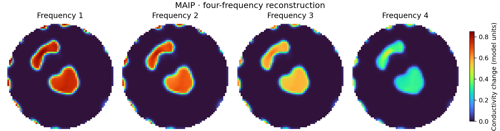

# MAIP: Multifrequency EIT Reconstruction

Code and numerical inputs for **Multifrequency Electrical Impedance Tomography
Reconstruction With Multibranch Attention Image Prior**, IEEE Internet of Things
Journal, 13(2), 1862–1874, 2026.

[Paper](https://ieeexplore.ieee.org/abstract/document/11214340) ·
[DOI](https://doi.org/10.1109/JIOT.2025.3624228) ·
[中文说明](README_zh.md) · [Data format](data/README.md)

MAIP fits a four-branch attention image prior to four-frequency voltage
measurements using a sensing operator. Each reconstruction starts from a seeded,
randomly initialized network; no training images or pretrained weights are needed.



## Run the demo

Use Python 3.10 or newer. In the repository root:

```bash
python -m pip install -r requirements.txt
python run_demo.py
```

The default reconstructs `case2_sim`, the same input as `V_P6.txt` in the archived
inference script. It uses the original four-branch network, 64 × 64 grid,
950 Adam iterations, learning rate `1.2e-4`, seed `2`, and mean absolute voltage
error. CUDA is selected when available; CPU execution is also supported. A GPU
is recommended for complete reconstructions.

Outputs are written to `results/`:

- `reconstruction.png`: four frequency channels with one shared amplitude scale.
- `reconstruction.npz`: raw FEM coefficients, images, fitted voltages and attention weights.
- `conductivity.txt`: four rows of FEM conductivity coefficients, matching the original export.
- `loss.csv`, `loss.png`: voltage fitting history.
- `attention.png`: learned frequency mixing and channel scales.
- `run.json`: configuration, timing and voltage residuals.

Existing reconstruction files are not overwritten. Choose a different `--output`
directory for another run. Stored fields retain their amplitudes; the figure
uses the supplied mesh-position table and masks the exterior without thresholding.

## Other supplied measurements

```bash
python run_demo.py --list-cases
python run_demo.py --case DBLung_sim --output results/lung
python run_demo.py --case zebrafish_realworld --output results/zebrafish
```

Eight sets of four-frequency measurements are included: three simulation cases,
a simulated lung, a measured lung, simulated and measured test examples, and a
measured zebrafish example. Circular and thoracic sensing operators and projection
matrices are supplied. See [data/README.md](data/README.md) for their mapping.
The default settings reproduce the archived simulation entry point; they are
configurable for other observations with `--epochs` and `--learning-rate`.

## Quick checks and visualization

```bash
# Check installation; five iterations are not a converged reconstruction.
python run_demo.py --epochs 5 --output results/smoke

# Explicit CPU execution.
python run_demo.py --device cpu --epochs 5 --output results/cpu-smoke

# Regenerate figures from the included complete reconstruction without fitting.
python visualize.py

# Check data integrity, projection alignment and gradient flow.
python -m unittest discover -s tests -v
```

## Use the implementation

```python
from maip.data import load_case
from maip.reconstruction import Config, reconstruct

measurement = load_case("case2_sim")
arrays, info = reconstruct(measurement, Config(), device="auto")
coefficients = arrays["coefficients"]  # (4, number_of_mesh_elements)
images = arrays["images"]            # (4, 64, 64)
```

To use your own measurements with a supplied geometry, replace the `voltages`
field using `dataclasses.replace(measurement, voltages=your_array)`. The float32
array must have shape `(104, 4)` and retain the corresponding voltage convention,
measurement ordering and frequency-column ordering. Changing geometry requires
matching sensitivity and projection matrices and a mesh-position table.

The implementation is in `maip/model.py` and `maip/reconstruction.py`. Active
network classes, initialization and inference arithmetic follow the authors'
archived `MBUnets_LayerNorm.py` and `inference.py`. Unused alternative networks,
interactive plotting, profiling code and experiment logs are omitted.
The original two-step sensitivity normalization is retained, including its
float64-to-float32 conversion. Numerical data are losslessly packaged in NPZ files.

The source inputs do not contain conductivity ground truth, so the example reports
voltage fitting error. Physical frequency labels were not supplied with these
files; figures retain the original column order as Frequency 1–4. Different
devices and PyTorch versions can produce floating-point differences.

## Citation and license

If you use this code, the data or the MAIP method in your work, please cite:

H. Fang, Z. Liu, Y. Feng, Z. Qiu, P.-O. Bagnaninchi, S. Yuan, H. He, and Y. Yang,
“Multifrequency Electrical Impedance Tomography Reconstruction With Multibranch
Attention Image Prior,” IEEE Internet of Things Journal, vol. 13, no. 2,
pp. 1862–1874, 2026. DOI: [10.1109/JIOT.2025.3624228](https://doi.org/10.1109/JIOT.2025.3624228).

```bibtex
@article{fang2026maip,
  author = {Fang, Hao and Liu, Zhe and Feng, Yi and Qiu, Zhen and
            Bagnaninchi, Pierre-Olivier and Yuan, Siyi and He, Huaiwu and Yang, Yunjie},
  title = {Multifrequency Electrical Impedance Tomography Reconstruction
           With Multibranch Attention Image Prior},
  journal = {IEEE Internet of Things Journal},
  year = {2026},
  volume = {13},
  number = {2},
  pages = {1862--1874},
  doi = {10.1109/JIOT.2025.3624228}
}
```

GitHub's **Cite this repository** entry provides this paper as the preferred
citation. A BibTeX file is included as `citation.bib`.

Code and the authors' numerical inputs are distributed under the [MIT license](LICENSE).
